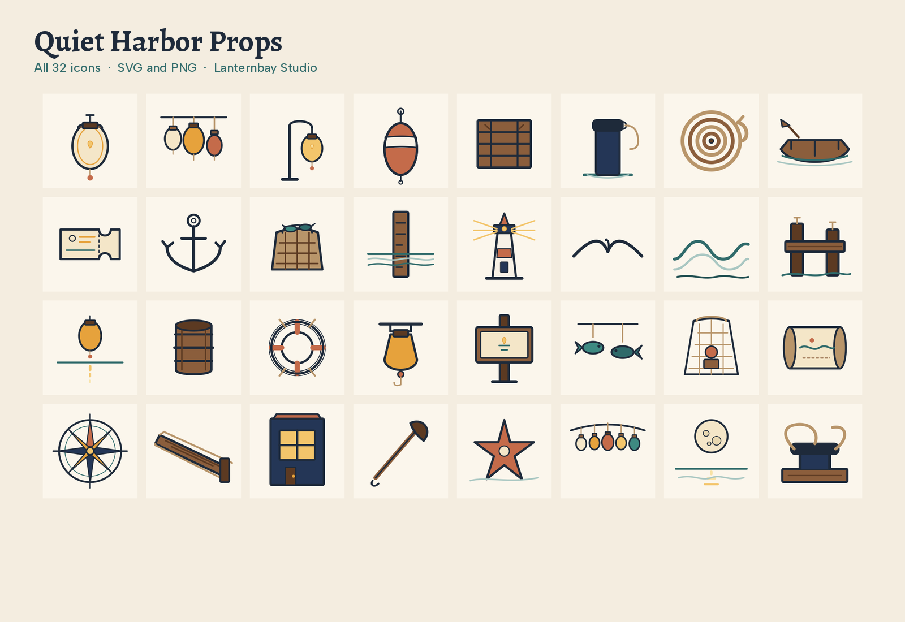

# Quiet Harbor Props

A free pack of **32 coastal and harbor vector props** for 2D games, visual novels, maps and UI decoration: lanterns, buoys, crates, rope, a lighthouse, a rowboat, a compass rose and more.

**Download the full pack (free) on itch.io:** https://csvclinic.itch.io/quiet-harbor-props

A small interactive HTML5 canvas sample scene that uses these props is in [quiet-harbor-sample-scene](https://github.com/dtpnm857jk-create/quiet-harbor-sample-scene). You can [play it online](https://dtpnm857jk-create.github.io/quiet-harbor-sample-scene/).

## What's in the pack

- `svg/`: 32 standalone SVG files (256 viewBox, scalable)
- `png/256/` and `png/512/`: PNG exports of all 32 icons at 256×256 and 512×512 px
- `sheets/`: a contact sheet of all 32 icons
- A documented 12-color palette (hex values in the pack's README). The SVGs are easy to recolor.
- `source/`: the Python script that drew the icons

This repository only holds a preview, four sample SVGs (`samples/`), the license and the build script (`tools/build_pack.py`). The complete pack is distributed on itch.io.

## License (summary of LICENSE.txt)

Free to use, copy, modify and include in commercial or non-commercial games, apps, videos, streams, educational materials and other original works, on these conditions:

1. Credit "Lanternbay Studio". A line such as *Harbor props by Lanternbay Studio* is enough.
2. Don't redistribute the original files, or a lightly modified copy, as a standalone asset pack, icon set or stock collection.
3. Don't claim authorship of the original assets.
4. No trademark rights are granted.
5. Provided "as is", without warranty.

The full terms are in [LICENSE.txt](LICENSE.txt), and they take precedence over this summary.

## AI disclosure

Made with AI assistance. The vector shapes were drawn programmatically by AI-written code; no image-generation models or stock images were used.

## Credits

Art and packaging: **Lanternbay Studio**, 2026.
